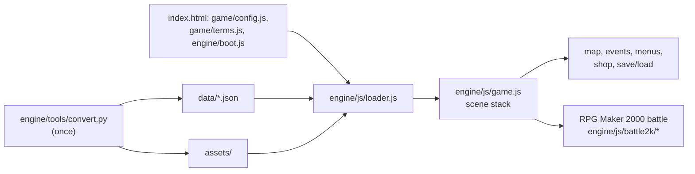

# Saint Seiya RPG - Asgard Chapter (browser remake)

A browser remake of the Brazilian fan game *Saint Seiya RPG - Asgard Chapter* (v2.00),
originally made with RPG Maker 2000. The original project data (maps, database, events)
is converted to JSON by a Python tool and played by a vanilla JavaScript runtime that
reimplements the RPG Maker 2000 engine: tile maps with autotiles, events and move routes,
message windows with the original bitmap fonts, menus, shops, inns, front-view battles,
pictures, screen effects and save/load.

No build step, no dependencies: open `index.html` over HTTP (GitHub Pages works).

## Play

```bash
python3 engine/tools/serve.py 8090
```

Then open <http://localhost:8090>.

| Action          | Keyboard                         | Touch |
|-----------------|----------------------------------|-------|
| Move            | Arrows / WASD                    | D-pad |
| Confirm / talk  | Z, Enter, Space                  | Z     |
| Cancel / menu   | X, Esc, C                        | X     |
| Run             | Shift                            |       |

The **EN/PT** button in the top bar switches the interface language. Dialogue stays in
the original Portuguese; menu and battle vocabulary switches to English.

Test entry points: `?map=3&x=19&y=28` (start on a map), `?battle=3` (start a battle with a troop),
`?party=1,2` (choose the party), `?seed=42` (repeatable random numbers).

## Checks

```bash
scripts/check                 # engine copy intact, game contract tests, clean-code audit
npx playwright test           # title, maps, battle, save/load (+ an old save), screenshots in e2e/screenshots/
```

## Architecture

The runtime and converter are shared with the RPG Maker 2003 remake *holy-avenger*: they live in
the sibling repo `rpgmaker-web-engine` and are vendored here as `engine/` (`engine/VERSION` names
the commit). This repo keeps only what is specific to this game. Never edit `engine/` here; fix
the engine repo, commit, and run `../rpgmaker-web-engine/scripts/vendor-engine .`.

```
index.html, game/          page shell; game/config.js (save keys), game/terms.js (English terms:
                           Cosmo, Cloth, Technique...); index.html loads them, then engine/boot.js
engine/                    vendored shared engine: js/ runtime, tools/ converter + dev server,
                           testing/ (vm harness and the game contract tests), style.css
data/                      converted game data (database.json, maptree.json, maps/*.json, manifest.json)
assets/                    converted graphics (RGBA PNG), audio (OGG) and bitmap fonts
tests/, e2e/               game contract tests (node --test), Playwright specs + screenshots
```



## Regenerating the data

```bash
scripts/setup
.venv/bin/python engine/tools/convert.py \
  --game "/path/to/Saint Seiya RPG - Asgard Chapter" \
  --rtp "/path/to/RTP/2000" \
  --sf2 /usr/share/sounds/sf2/default-GM.sf2
python3 engine/tools/fon2png.py "/path/to/game/System/Rmg2000.fon" assets/font/rmg2000.png assets/font/rmg2000.json
python3 engine/tools/fon2png.py "/path/to/game/System/Rm2000.fon"  assets/font/rm2000.png  assets/font/rm2000.json
```

`convert.py` needs Pillow and `ffmpeg`; MIDI music is rendered with `tinysoundfont` and a
GM SoundFont. Assets missing from the project folder are taken from the RTP folder(s). The shared
converter reproduces the committed `data/` and images byte for byte (checked 2026-10-21).

## Engine notes

- Screen is 320x240, tiles 16px, 60 fps, movement in 1/256-tile steps like RPG_RT.
- Chipset autotiles, passability and terrain follow EasyRPG's documented layout.
- Text uses the game's own `.fon` fonts with the System graphic's colour cells and a
  fixed 6px advance, so accents render exactly like the original.
- Battle formulas (hit, critical, damage, variance, EXP curve) follow RPG Maker 2000. Critical
  hits use RPG Maker's "1 in N" actor rate plus the weapon bonus (before the shared engine the
  remake used N as a percentage, which made critical hits far more frequent).
- Saves live in `localStorage` (15 slots) and store switches, variables, party, items,
  map position, event positions, screen tint and weather.

## Credits and licensing

The game, its story, sprites and music arrangements belong to their original fan
authors; Saint Seiya is © Masami Kurumada / Toei Animation. Several graphics and songs
come from the RPG Maker 2000 RTP, whose license restricts use to RPG Maker games. Keep
that in mind before publishing the `assets/` folder. The runtime code in `engine/` is original;
`engine/tools/lcf/*.csv` come from the liblcf project (MIT).
